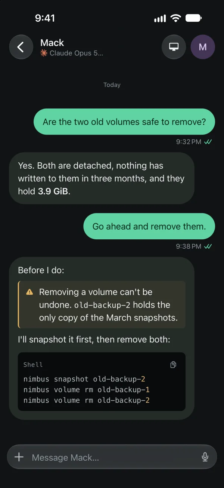
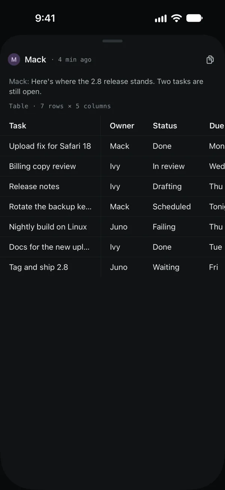
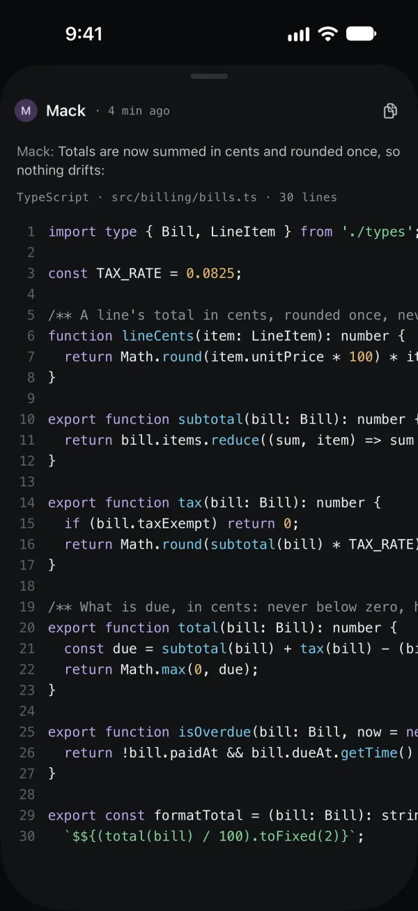
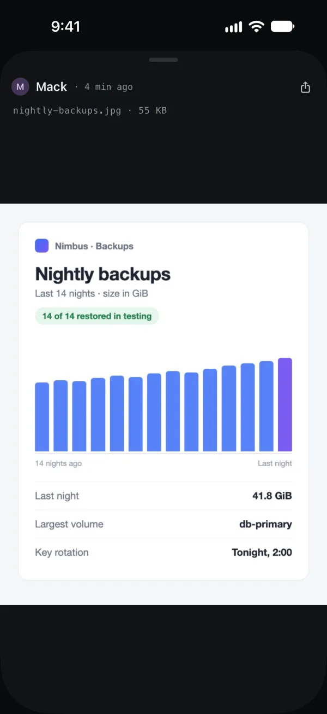
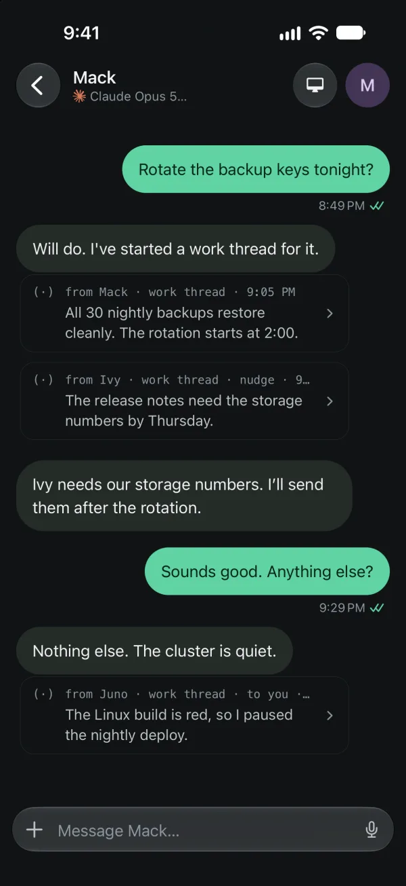
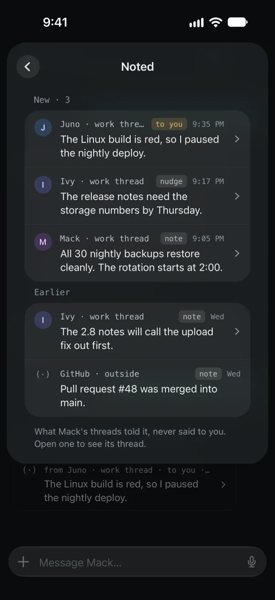
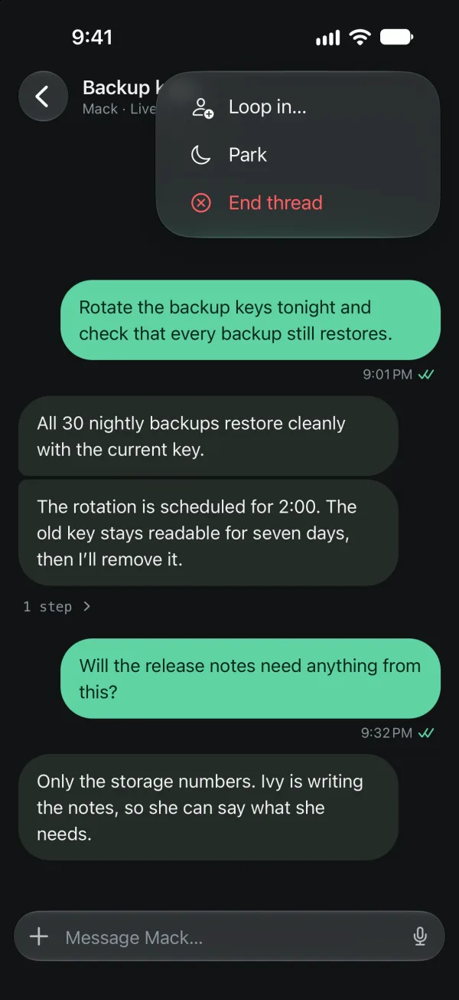
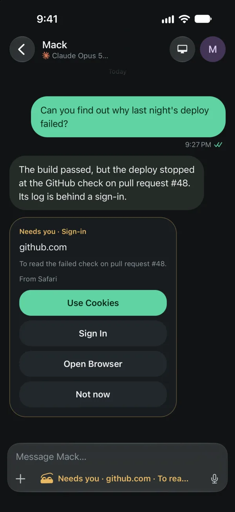
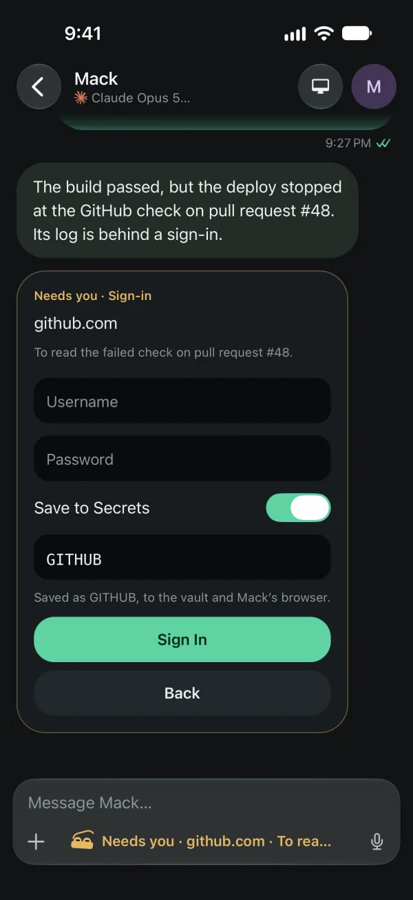
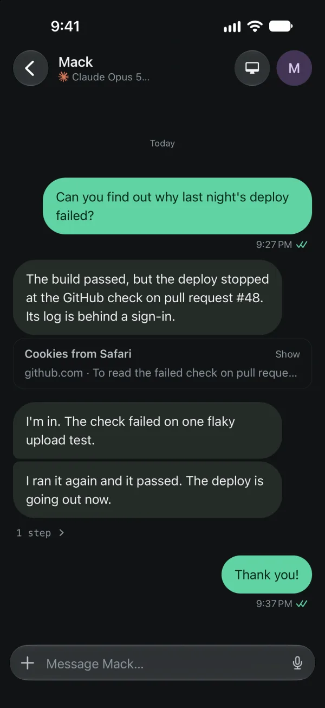

## The team list

Every teammate on your linked desks, with what each is doing. A teammate
waiting on you says **Needs you** and comes first. Search at the bottom finds
a teammate. The **+** beside it adds one: a name, an optional goal, and what
it runs on. The desk must be one that can add teammates from a phone.

## A conversation

Type and send. Replies stream in as the teammate writes them, and it keeps
working while the phone is closed.

- **+** beside the box attaches **Photos**, **Camera**, **Files**, or
  **Paste image** when there is an image to paste.
- Swipe a message left to reply to it.
- A wide table or a long piece of code is cut to fit, with a line saying
  what it is; tap it to open it.
- A file a teammate sends opens in place.

In a message, code names its language and file and colours its syntax, and
a block of one line wraps. A `[!WARNING]` or `[!CAUTION]` quote is a
callout. A straight-line flow reads as its steps; any other diagram shows
its source, named Diagram.

An opened table or code block, picture, document or page fills a sheet; pull
it down to close it. Its band shows who said it and how long ago, with
**Copy**, and over it what it is ("Table · 7 rows × 8 columns",
"TypeScript · bills.ts · 24 lines"). A table keeps its head row and first
column in place as it scrolls; code is numbered there.

 

The desk's owner sees the desk's colours: its **Accent** on your bubble,
**Send** and the call keys, and each teammate's **Bubble** on its replies,
from desk 0.47.

## Threads

- An aside, what a teammate's threads and colleagues told it without
  telling you, is a quiet (·) line in its conversation. Tap it to open the
  thread it came from.
- **Noted**, on the teammate's card between **Threads** and **Search**,
  lists its asides under New and Earlier, with a count of the new ones.
- **Loop in…**, in a work thread's menu, asks a colleague to answer once in
  the thread. **End thread** is in the same menu.
- You can talk in a thread one teammate handed to another. A bar says when
  the handoff has ended.

 

See [Teammates working together](/docs/use/teammates-together/).

## When a teammate is waiting on you

A card in the conversation says what the teammate needs:

| Card | Your answers |
| --- | --- |
| Permission to use a tool | **Allow** or **Deny** |
| **Needs you**: something only you can do, like a sign-in | **Done** or **Won't do** |
| A passkey to create | **Approve** or **Deny** |
| A site to sign in to | **Use Cookies**, **Sign In**, **Open Browser** or **Not now** |

The same buttons are on the notification, except a sign-in's, which offers
**Use Cookies** and **Not now**. Your phone asks you to unlock it first,
then sends the answer.

### A sign-in

A teammate that needs to be signed in to a site asks with the site and its
reason, and counts as **Needs you** until you answer:

- **Use Cookies** shares that site's cookies from your browser on the desk,
  named under the buttons; choose one when several have it. The phone asks
  for Face ID first, and the cookies go from the desk to the teammate,
  never through the phone.
- **Sign In** takes a username and password in the card. **Save to
  Secrets** keeps the login on the desk. The teammate never sees either.
- **Open Browser** opens the teammate's computer screen for you to sign in
  yourself. It is offered only for a teammate with a computer.
- **Not now** declines; it won't ask for that site again until you next
  write to it.

 

Once answered, the card folds to one line, such as "Cookies from Safari",
with **Show** to open it again.

See [Sign-ins](/docs/setup/sign-ins/) for what each answer does on the desk.
